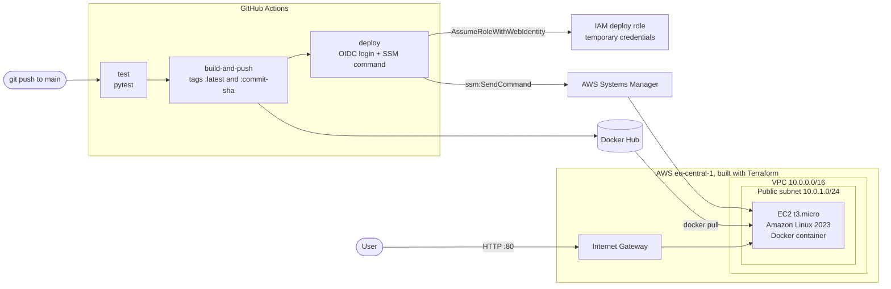
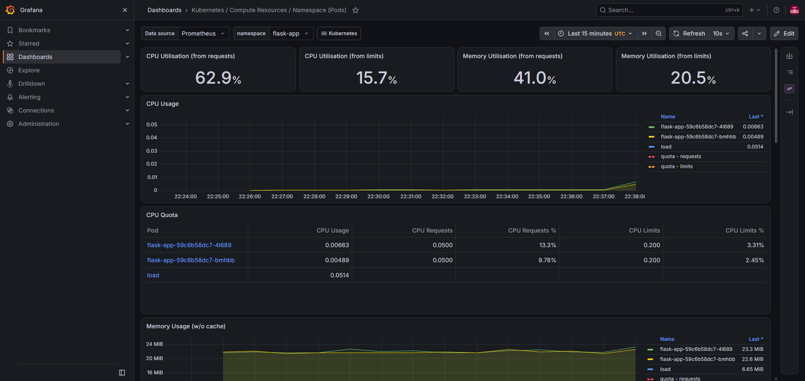
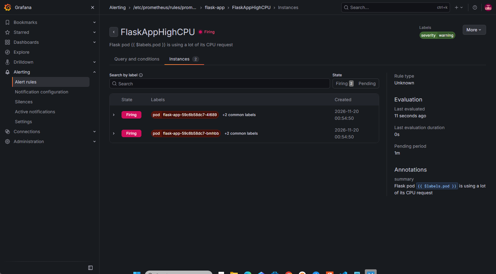

# Flask App on AWS: Terraform + GitHub Actions CI/CD

A Python Flask app, containerized with Docker, running on AWS EC2.
The infrastructure is written in **Terraform**, and every push to `main` is **tested, built and deployed automatically** by GitHub Actions.

**No SSH. No open admin ports. No AWS keys stored in GitHub.**

---

## Architecture



---

## How the pipeline works

| Job | What it does |
|---|---|
| **test** | Installs dependencies and runs `pytest`. If a test fails, the pipeline stops and nothing is deployed. |
| **build-and-push** | Builds the Docker image and pushes it to Docker Hub with two tags: `latest` and the **commit SHA**. |
| **deploy** | Logs into AWS with **GitHub OIDC**, finds the server by its `Name` tag, and uses **SSM Run Command** to pull the new image, replace the container and run a **health check**. If the health check fails, the job fails. |

Each job only starts if the one before it passed: `test → build-and-push → deploy`.

---

## Infrastructure (Terraform)

All AWS resources are created from the [`terraform/`](terraform/) folder.

| File | What it creates |
|---|---|
| `versions.tf` | Terraform and AWS provider versions, region |
| `variables.tf` | `region` and `project` name |
| `network.tf` | VPC, Internet Gateway, public subnet, route table |
| `security.tf` | Security group: HTTP (80) in, all traffic out |
| `ec2.tf` | Latest Amazon Linux 2023 AMI lookup and the EC2 instance |
| `user_data.sh` | First-boot script: installs Docker and starts the app container |
| `iam.tf` | EC2 role with `AmazonSSMManagedInstanceCore`, so SSM can manage the server |
| `github_oidc.tf` | GitHub OIDC provider and a least-privilege deploy role for this repo's `main` branch |
| `outputs.tf` | App URL and deploy role ARN |

---

## Design decisions

- **OIDC instead of access keys.** GitHub proves its identity to AWS and receives credentials that expire after about an hour. Nothing long-lived is stored, so nothing can leak.
- **SSM instead of SSH.** No port 22, no key pairs, no IP addresses in the pipeline. The server is found by its tag, so it still works after Terraform replaces it.
- **Least privilege.** The deploy role can only send commands to this one instance and read their results. Only this repository's `main` branch can assume it.
- **Immutable image tags.** Every deploy runs the exact image that passed the tests (`:commit-sha`), which also makes rollbacks easy.
- **Health check as a gate.** The deploy job runs `curl` against `/health` on the server, so a broken release shows up as a red pipeline instead of a silent outage.
- **Public subnet, no NAT Gateway or load balancer.** This keeps the cost near $0 for a learning project. A production setup would use private subnets, an Application Load Balancer and an Auto Scaling group for zero-downtime deploys.

---

## Run it yourself

**Prerequisites:** an AWS account with the AWS CLI configured, Terraform 1.5 or newer, a Docker Hub account.

1. **Create the infrastructure**
   ```bash
   cd terraform
   terraform init
   terraform apply
   ```
2. **Point the OIDC trust at your repo.** In `github_oidc.tf`, set the `sub` condition to your repository. GitHub's current format includes the owner and repo IDs:
   `repo:<owner>@<owner-id>/<repo>@<repo-id>:ref:refs/heads/main`
3. **Set your image name** in `user_data.sh` (`<dockerhub-user>/flask-app:latest`).
4. **Add GitHub repository secrets** (Settings → Secrets and variables → Actions):
   - `DOCKERHUB_USERNAME`
   - `DOCKERHUB_TOKEN`
   - `AWS_ROLE_ARN`: the value of `terraform output github_deploy_role_arn`
5. **Push to `main`** and watch the Actions tab.
6. **Open the app:**
   ```bash
   curl $(terraform output -raw app_url)
   # {"status":"healthy"}
   ```

### Run locally

```bash
docker compose up --build
# http://localhost:5000/health
```

Run the tests:

```bash
pip install -r requirements.txt
pytest
```

---


## Run on Kubernetes

The [`k8s/`](k8s/) folder deploys the same Docker image to Kubernetes. It was tested on a local [kind](https://kind.sigs.k8s.io/) cluster.

| File | What it creates |
|---|---|
| `namespace.yaml` | A dedicated `flask-app` namespace |
| `configmap.yaml` | App settings (`APP_ENV`, `LOG_LEVEL`) |
| `deployment.yaml` | 2 replicas pinned to a commit-SHA image, with readiness and liveness probes on `/health`, CPU and memory limits, and settings injected from the ConfigMap and Secret |
| `service.yaml` | A ClusterIP Service in front of the pods |
| `gateway.yaml` | A Gateway API `Gateway` and `HTTPRoute` that send `flask.local` to the Service |

### Deploy

```bash
kind create cluster

# Gateway API controller for kind
VERSION="$(basename $(curl -s -L -o /dev/null -w '%{url_effective}' https://github.com/kubernetes-sigs/cloud-provider-kind/releases/latest))"
docker run -d --name cloud-provider-kind --rm --network host -v /var/run/docker.sock:/var/run/docker.sock registry.k8s.io/cloud-provider-kind/cloud-controller-manager:${VERSION}

kubectl apply -f k8s/namespace.yaml
kubectl create secret generic flask-secret -n flask-app --from-literal=DB_PASSWORD=<your-password>
kubectl apply -f k8s/
```

## Monitoring (Prometheus + Grafana)

The Kubernetes deployment is monitored with the **kube-prometheus-stack** Helm chart (Prometheus, Grafana, Alertmanager, kube-state-metrics, node-exporter). The configuration lives in Git, so the whole setup can be rebuilt with two commands.

| File | Purpose |
|---|---|
| `monitoring/values.yaml` | Helm values: Grafana in local time, 2-day metric retention |
| `monitoring/alerts.yaml` | `PrometheusRule` with the app's alert rules |

**Alert rules**

| Alert | Fires when | Severity |
|---|---|---|
| `FlaskAppHighCPU` | A pod uses more than 80% of its CPU request for 5 minutes | warning |
| `FlaskAppPodRestarting` | A pod restarts more than 2 times in 10 minutes (crash loop) | critical |

**Install**

```bash
helm repo add prometheus-community https://prometheus-community.github.io/helm-charts
helm repo update
helm install monitoring prometheus-community/kube-prometheus-stack \
  -n monitoring --create-namespace -f monitoring/values.yaml
kubectl apply -f monitoring/alerts.yaml

# Grafana: user "admin", password from the secret
kubectl -n monitoring get secret monitoring-grafana -o jsonpath="{.data.admin-password}" | base64 -d; echo
kubectl -n monitoring port-forward svc/monitoring-grafana 3000:80   # http://localhost:3000
```

**Load test result:** under a `curl` load loop, CPU per pod rose about 13x and was split evenly across both replicas by the Service. At idle, the pods use about 1% of their 50m CPU request, which shows the requests could be right-sized.




*For this screenshot the CPU threshold was temporarily lowered to 8% so the alert could be triggered on purpose.*


### Test

```bash
kubectl get gateway -n flask-app   # note the ADDRESS
docker run --rm --network kind curlimages/curl -s -H "Host: flask.local" http://<ADDRESS>/health
# {"status":"healthy"}
```

### Design notes

- **The Secret is not in Git.** It's created with `kubectl create secret`, so the password never lands in the repository.
- **Pinned image tag.** The Deployment uses the commit-SHA tag built by the CI pipeline, so the running version is always known. `kubectl rollout undo` returns to the previous version.
- **Gateway API instead of Ingress.** The community ingress-nginx controller was retired in March 2026, and Gateway API is its official successor.
- **Portable.** Only `gatewayClassName` is kind-specific. On a cloud cluster, point it at that cloud's Gateway controller.


## Cost

The VPC, subnet, route table, Internet Gateway, security group and IAM resources are free.
The EC2 instance and its public IPv4 address are billed per hour while they run, so destroy everything when you're done:

```bash
terraform destroy
```

While the infrastructure is destroyed, the `deploy` job fails on purpose with a clear message: *"No running server found. Did you run terraform apply?"*

---

## Lessons learned

- **Terraform removes the default egress rule** from security groups it creates. Without an explicit `egress` block, the server can't install Docker.
- **GitHub's OIDC `sub` claim includes numeric owner and repo IDs.** The trust policy failed until I decoded the token's claims in a debug step and matched the exact value.
- **The SSM agent registers only after the instance has a role.** Attaching the role to a running instance needed a reboot before the agent came online.
- **Check the region first.** An empty AWS CLI result turned out to be a default region mismatch, not a missing resource.

---

## Tech stack

Python · Flask · pytest · Docker · Docker Hub · Terraform · AWS (VPC, EC2, IAM, Systems Manager) · GitHub Actions · Kubernetes · Gateway API . Helm . Prometheus . Grafana